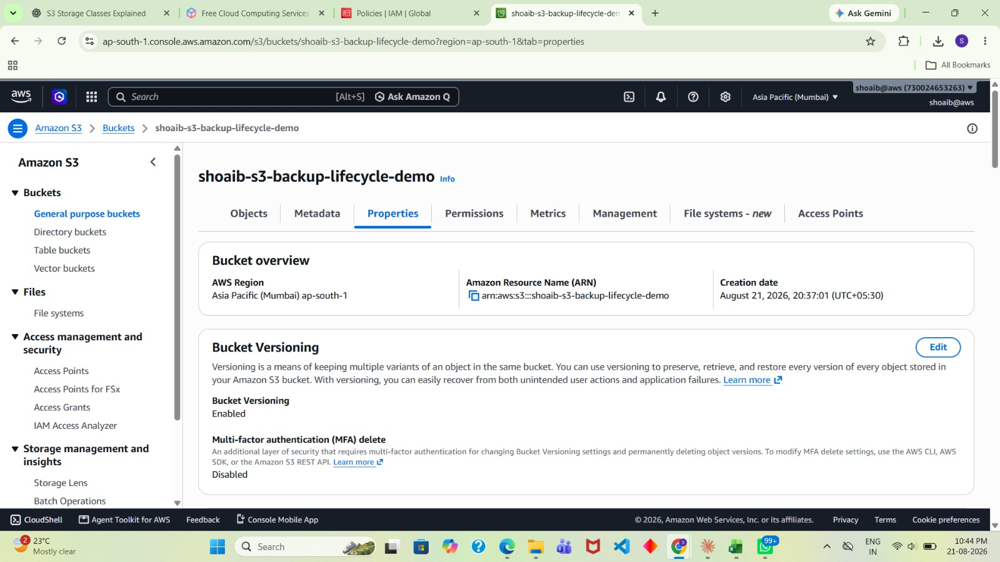
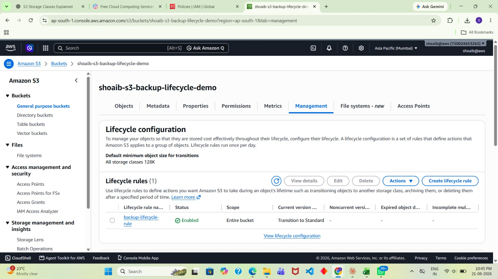
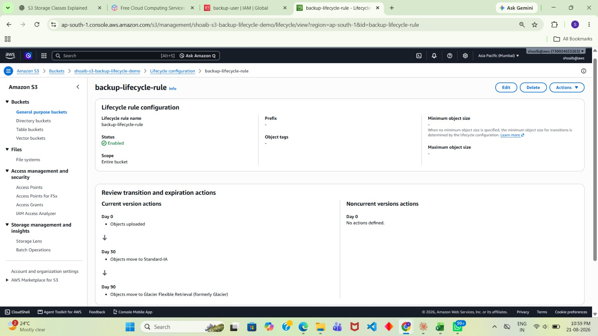
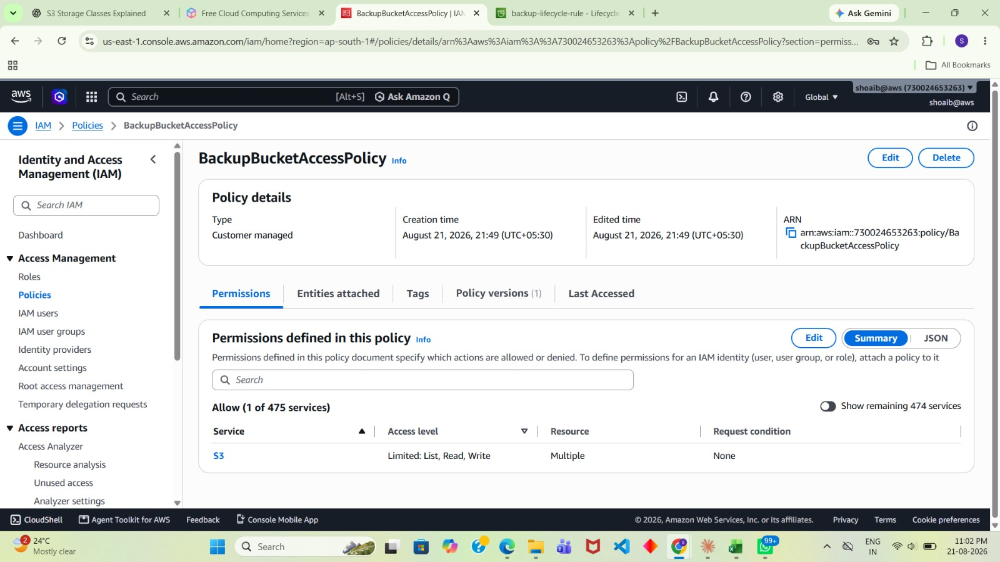
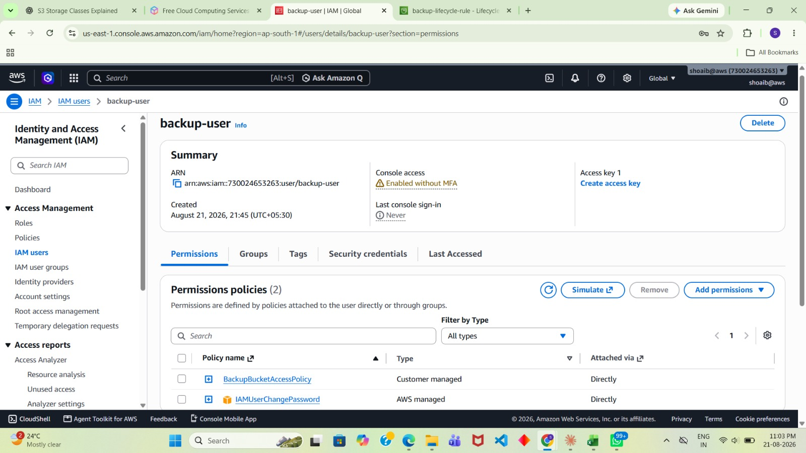

# 🚀 Automated S3 Backup & Lifecycle Management System

## 📌 Project Overview
This hands-on AWS project demonstrates secure object storage, data protection, and automated storage cost optimization using Amazon S3 and AWS IAM.

## 🎯 Project Objectives
- Protect objects using S3 Versioning.
- Automate storage lifecycle transitions.
- Apply least-privilege access using IAM.
- Manage backups, documents, and logs securely.

## 🛠️ AWS Services Used
- Amazon S3
- AWS IAM
- S3 Versioning
- S3 Lifecycle Management

## ⚙️ Key Implementations
- Created an S3 bucket with structured storage for documents, backups, and logs.
- Enabled S3 Versioning to help recover from accidental overwrites or deletions.
- Configured lifecycle transitions from S3 Standard to Standard-IA and Glacier Flexible Retrieval.
- Created a dedicated IAM user with controlled S3 access.
- Designed a custom IAM policy following the principle of least privilege.
- Tested object versioning and reviewed lifecycle configurations through the AWS Console.

## 🧠 Key Learnings
- S3 object versioning and recovery
- Lifecycle rules and storage class transitions
- IAM policies and least-privilege access
- Cloud storage security and cost optimization

## 📸 Project Screenshots

### 1. S3 Bucket Objects

### 2. S3 Versioning Enabled

### 3. S3 Lifecycle Configuration

### 4. IAM Backup Bucket Policy

### 5. S3 Lifecycle Rule Configuration

### 6. IAM S3 Backup Bucket Access Policy

### 7. IAM Backup User Permissions

## 🔐 Security Notes
- No AWS access keys, secret keys, or passwords should be committed.
- Lifecycle transitions depend on the configured rules and object eligibility.
- Review IAM permissions before using them in production.

## 👨‍💻 Author
Shoaib Mangalgi

DevOps Trainee | AWS | Linux | Cloud Computing
